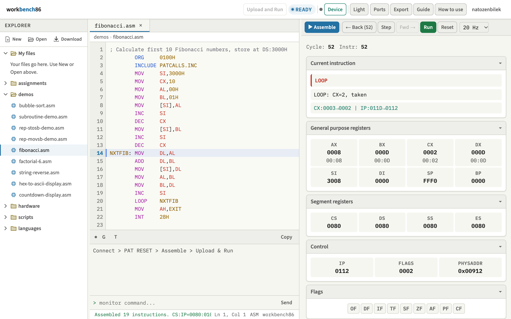
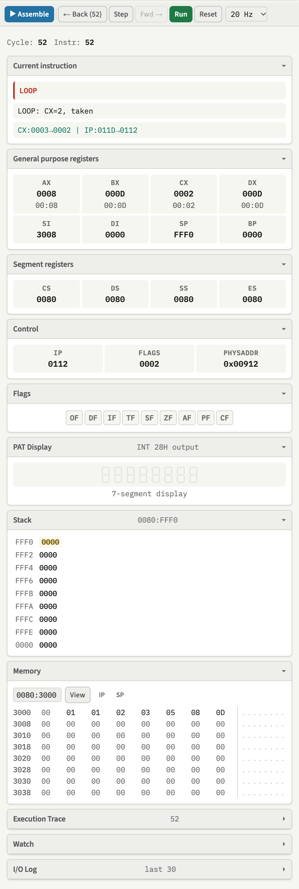

# workbench86

Türkçe: [README.tr.md](README.tr.md)

workbench86 is the bench for the DIGIAC 2000 lab trainer, in a browser. You write 8086 real-mode assembly, run it in a simulator whose debugger steps backwards as well as forwards, watch the trainer board's I/O ports react, and upload the assembled bytes to the physical board over WebSerial.

Live demo: <https://natozenbilek.github.io/workbench86/>. Step by step guide: <https://natozenbilek.github.io/workbench86/howto/>.

<picture>
  <source media="(prefers-color-scheme: dark)" srcset="docs/screenshots/overview-dark.png">
  
</picture>

The page opens in the dark theme on a first visit. The theme button in the header names the current theme, Dark or Light, switches to the other one, and the choice is remembered. GitHub shows the screenshot that matches your own theme.

This README describes build v18. Changes are in [CHANGELOG.md](CHANGELOG.md), open problems in [docs/KNOWN_ISSUES.md](docs/KNOWN_ISSUES.md).

## Why this exists

The target board is the DIGIAC 2000 Microprocessor Training System from LJ Technical Systems, specifically its 80286 CPU card. In the lab that card is called "PAT". That is a local term used at Hacettepe University, not a name the vendor uses. The board is used in BBM436 Microprocessors Lab at Hacettepe University Computer Engineering, and at Istanbul Technical University.

The board is modular. A chassis holds the CPU card and a keypad and display module, and an Applications Module carries the peripherals: LEDs, a DC motor with an optical disc encoder, a potentiometer, an ADC and a DAC, an ultrasonic transmitter and receiver, an optical link and a piezo sounder.

The way you write for this board is Merlin, the command line assembler that comes with it. You write the program, assemble it, and deposit the bytes into the board's ROM monitor, which is also where `PATCALLS.INC` and the INT 28H call set come from. What Merlin does not give you is a view of the machine: there is no register or memory display while the program runs, no way to go back one instruction after you miss what happened, and no way to try anything at all without a physical board in front of you, which in practice means waiting for a lab session.

workbench86 puts a full IDE around the same workflow without changing it. It does not replace the board, and it does not replace Merlin's conventions either: a program written against `INCLUDE PATCALLS.INC` assembles here unchanged, so the existing lab material still works. The byte stream the simulator executes is the byte stream the upload sends, so the simulator is where you get a program right before it goes to hardware.

workbench86 is a single page application. There is no build step, no backend and no library or framework. It is about 6.6 kLOC of JavaScript across 32 files and 1.6 kLOC of CSS across 7 files, all vanilla. The How to use page adds one script and one stylesheet (about 0.8 kLOC together), and the test harness three scripts (0.3 kLOC). It runs from any static host, and most of it runs from `file://`. The only request to another host is for three web fonts from Google Fonts; offline, the page falls back to system fonts such as Consolas and Segoe UI. The How to use page bundles its own fonts.

## Quick start

Clone the repository and open `index.html`:

```bash
git clone https://github.com/natozenbilek/workbench86.git
cd workbench86
open index.html        # macOS
xdg-open index.html    # Linux
start index.html       # Windows
```

The editor, the assembler, the simulator and the debugger all work this way. Two things do not. The example corpus is loaded with `fetch`, which the browser blocks over `file://`, so the four example folders in the Explorer stay empty; the built-in samples under `languages` still open. WebSerial needs a secure context. For both, serve the directory over HTTP:

```bash
python3 -m http.server 8000
```

Then open <http://localhost:8000>.

Your first program:

1. In the Explorer, open `demos` and click `fibonacci.asm`. Opening an example assembles it and loads it into the simulator. `Ctrl+Enter` assembles again after you edit it.
2. Press `Step` a few times. The Current instruction card at the top of the debug panel shows the mnemonic, what it did and the registers that changed.
3. Press `← Back` to undo a step and `Fwd →` to redo it. Registers, memory, ports and peripheral state rewind together.
4. Press `Run` (20 Hz by default) to run freely, and `Pause` to stop. Run is not recorded, so `← Back` after a Run returns to the state before your last Step.

## How to use page


A step by step guide lives in [howto/](https://natozenbilek.github.io/workbench86/howto/) and opens from How to use in the app's header. At a window width of 1024 px or less it is the first item of the header's ⋮ menu. It has 57 cards, each in Turkish and English: serial basics (RS-232, TX and RX, 9600 8N2), working in the simulator, uploading to the board (PAT RESET, a fresh `PAT:`, `C` and `G` with the 0080 segment), board mode and the error codes.

The language follows the browser. `?lang=tr` or `?lang=en` in the address picks one, and the TR | EN switch is remembered. The page opens in the app's theme. The arrow keys, Space, Page Up and Page Down, Home and End move between cards, and Present (or `F`) shows one card at a time, full screen, until `Esc`. Speaker notes, in Turkish only, appear when the address has `?notes`. The board replies in its screenshots come from a model of the PAT monitor, so a real board may look slightly different.

## Feature tour

### Explorer and files

The Explorer has New, Open and Download buttons at the top. The folders are, in order, My files, assignments, demos, hardware, scripts and languages. `languages` holds eight built-in samples: `c/led_blink.c`, `python/counter.py`, `go/chase.go`, `java/blink.java`, `cpp/counter.cpp`, and `led_blink.asm`, `knight_rider.asm` and `fibonacci.asm` under `asm/`. A `generated` folder appears when Translate to ASM writes its first file.

New asks for a name and creates an `.asm` file in My files. Open accepts `.asm`, `.inc`, `.c`, `.cpp`, `.py`, `.java`, `.go` and `.txt` files from your computer and puts them in My files. Download, `Ctrl+S` or `Cmd+S` saves the open file under its own name, with CRLF line ends on Windows.

The examples and the samples cannot be renamed or deleted. You can edit one in its tab, but the edits stay in that tab; Make an editable copy puts a copy named `my-<file name>` in My files. Each row shows buttons on hover: Rename and Delete for your own files, Make an editable copy for the examples, and Download for both. Right-clicking a file, the empty part of the tree or a tab opens a context menu. The tab menu has Close, Close Others, Close All, Copy Path, Download, and Duplicate or Make an editable copy. A dot on a tab marks edits made since the file was opened or downloaded, and closing an edited example asks first.

My files lives in the page's memory only. A reload loses it, together with the open tabs, and the page does not warn you (it asks before leaving only while a board job is running). Download what you want to keep. Only the theme and the panel widths are remembered.

### Editor

Multi tab, with a breadcrumb above the text that shows the folder and the file. With no tab open, a welcome screen offers New file, Open a file from this computer and Start with assignment PA01. Syntax highlighting covers assembly and the five languages the transpiler reads. Hovering a mnemonic or a register shows what it does, and hovering a label or another name highlights its other uses.

Ghost completion works in `.asm` tabs. At the start of a statement it suggests mnemonics and directives; in the operand field it suggests registers, labels, `EQU` names and the `PATCALLS.INC` symbols. `Tab` accepts the suggestion, and otherwise inserts 8 spaces.

Find and replace is on `Ctrl+F` from the editor. It matches plain text, not regular expressions, ignores case unless the case toggle is on, and has Replace and Replace All. `Enter` and `Shift+Enter` move to the next and the previous match. The command palette on `Ctrl+Shift+P` finds its 19 commands by fuzzy match: assemble, run, step, step back and forward, reset, the theme, Ports, Export/Import, the ISA guide, Connect Device, Upload Program, the file actions, closing a tab, and collapsing or expanding all panels.

The undo stack is the editor's own, not the browser's. It keeps 200 states, `Ctrl+Z` and `Ctrl+Y` act only in the editor, and switching tabs starts a fresh history.

When the assembler finds errors, the messages appear in a banner above the editor and in the status bar, the lines are marked red in the line numbers, and the editor scrolls to the first one. `F1` opens the ISA reference guide, with Overview, Registers, Instructions, Addressing, and I/O & Peripherals tabs.

### Debug panel



The right hand panel is a column of collapsible cards.

| Card | Contents |
|---|---|
| Current instruction | Mnemonic, a plain description of the effect, and the change in AX, BX, CX, DX, SP, IP and FLAGS made by the last Step. This card cannot be collapsed |
| General purpose registers | AX, BX, CX and DX with their high and low bytes, then SI, DI, SP and BP. A register that changed flashes |
| Segment registers | CS, DS, SS, ES |
| Control | IP, FLAGS as hex, and the 20 bit physical address of CS:IP |
| Flags | OF, DF, IF, TF, SF, ZF, AF, PF, CF, with the set flags lit |
| PAT Display | The last 8 characters of INT 28H text output, drawn as a 7 segment display |
| Stack | 16 words from SS:SP upward, with the word at SP marked |
| Memory | 64 bytes in hex and ASCII, 8 to a row. Type `seg:off`, or a bare offset in segment 0080, and press View or `Enter`; the default is 0080:0100. The IP and SP buttons make the view follow CS:IP or SS:SP. Bytes that changed are highlighted |
| Execution Trace | Instructions executed with Step, with their register diffs. It keeps 500 and shows the last 80 |
| Watch | Up to 16 expressions: a register name, a hex `seg:off` such as `0080:1000`, a hex offset in DS such as `1000` or `[1000]`, a register in brackets such as `[SI]`, or a label, shown as its address and the byte at CS:label |
| I/O Log | The last 30 IN and OUT operations, with a timeline strip of the last 60 above them |

Above the cards, Cycle and Instr both count executed instructions; Cycle is not a count of 8086 clock cycles. Execution Trace, Watch and I/O Log start collapsed. Click a card's title to close or open it.

### Run controls

Assemble is `Ctrl+Enter` or the button. On a `.c`, `.cpp`, `.py`, `.java` or `.go` tab the same button reads Translate to ASM (see [Transpiler](#transpiler)). Opening an example, or switching back to its tab, assembles it and resets the simulator. Your own files and the language samples wait for Assemble.

Step executes one instruction. A string instruction with a `REP` prefix runs to the end in one Step. `← Back` undoes the last Step, and `Fwd →` redoes a step undone with Back, so Fwd is available only after Back. The number on Back, as in `← Back (52)`, is how many steps you can undo.

Run and Pause toggle free running at 5, 20, 100 or 500 Hz, or at Max, which runs instructions in batches of 500. The default is 20 Hz. Run records no history; see [How the simulator works](#how-the-simulator-works). When a program uses the MUART timer or `WTNMS` and runs below Max, the status bar shows `Tip: use Max speed (this program uses the MUART timer)`, or `WTNMS`, because both are paced by executed instructions and take minutes at the slower speeds.

Reset assembles the editor text again and clears the keyboard queue, the timer, pending interrupts and the piezo. It does not go back to a snapshot.

Clicking a line number sets or clears a breakpoint. A breakpoint stops Run, not Step, before the instruction on that line is executed, and the status bar says `Breakpoint: line n`.

The header pill shows READY, RUNNING, HALTED or ERROR. `INT 28H` EXIT and `HLT` halt the program, except that `HLT` with IF set and timer 1 enabled waits for the timer interrupt if the timer reaches zero within 100 more counts. A divide by zero, a quotient that does not fit, or an unknown opcode stops the program with ERROR; the simulator does not take INT 0. The status bar shows the last message. When it is cut off, hover over it to read all of it.

### Export and import

The Export dialog shows the program as an `addr: bb bb ...` dump of simulator memory in segment 0080, 8 bytes to a row, with all-zero rows skipped. It covers the range from the first to the last instruction plus 8 bytes, so data placed further on, such as a table after the code or a separate data `ORG`, is left out. Copy puts the dump on the clipboard. Download saves it as `workbench86_program.hex`, which holds this plain dump, not Intel HEX.

Import takes the same `addr: bb bb ...` form, pasted or loaded from a file. It clears memory, loads the bytes in segment 0080, sets CS, DS, SS and ES to 0080, SP to FFF0 and IP to 0100. Intel HEX records are not decoded. The import does not count as an assembled program: on a page where nothing has been assembled yet, Step and Run answer `No program assembled.` and `No program.`, Reset assembles the editor text over the imported bytes, and Upload and Run always sends the assembled editor text, never imported bytes.

## How the assembler works

The assembler reads Intel mnemonic syntax and produces one flat byte image. Labels are resolved by running the encoding pass again until no address moves, up to eight passes, so a forward reference that shortens an instruction settles instead of producing a wrong offset.

Directives: `ORG`, `EQU`, `DB`, `DW`, `END` and `INCLUDE PATCALLS.INC`. Expressions accept `OFFSET`, `BYTE PTR` and `WORD PTR`, the location counter `$`, and arithmetic on labels and constants.

Addressing modes: register, immediate, direct `[disp16]`, register indirect, based, indexed and based plus indexed, each with an optional segment override and an optional size qualifier.

`INCLUDE PATCALLS.INC` defines the port addresses and the INT 28H function numbers as constants, so a program can write `OUT UPORT1, AL` instead of `OUT 90H, AL`. The file is built into the assembler and is not read from disk. The names are defined even without that line, which is accepted and does nothing. Any other `INCLUDE` is an error.

Worth knowing before you write a program:

- The program is loaded at 0080:ORG. After Assemble, CS, DS, SS and ES are 0080, SP is FFF0 and IP is the ORG of the first instruction (0100H when there is no `ORG`). On the board SS and SP were different; see [Board notes](#board-notes).
- A bare label is its address, as an immediate: `MOV AX,TABLE` loads the address of TABLE. Write `[TABLE]` to read memory, and `LEA SI,[TABLE]`; `LEA SI,TABLE` is an error.
- A memory operand with an immediate and no `BYTE PTR` or `WORD PTR` is a word: `MOV [BX],5` assembles as `C7 07 05 00`.
- Numbers are decimal, hex with an `H` suffix and a leading digit (`0FFH`), or a quoted character. `$` works inside expressions such as `DW $`, but not as a jump target: write `HERE: JMP HERE` instead of `JMP $`.
- Expressions are evaluated with JavaScript's operators: `+ - * / & | ^ << >> ~` and parentheses. The MASM keyword operators `AND`, `OR`, `SHL` and `MOD` are not evaluated and give a wrong value without an error. `SEG` and `DUP` are not supported.
- Conditional jumps, `JCXZ` and the `LOOP` family are short only, and a target out of range is an error (`Branch too far`). `JMP` picks the short or the near form, and `CALL` is near.

## How the simulator works

The CPU model is 8086 real mode with a 1 MB memory image, the full register file, and FLAGS computed properly, including AF and OF on the arithmetic instructions. String operations run under the `REP`, `REPE`, `REPZ`, `REPNE` and `REPNZ` prefixes. Interrupts are taken from the modelled controller when IF is set.

Reverse execution is exact, not approximate. Before each Step the engine captures the registers, the port array, the peripheral state and the interrupt state, and hands the memory undo journal to that snapshot. The journal records the byte that was at an address before the first write since the previous snapshot, one entry per address, so undoing a step means replaying that journal. Stepping forward again works the same way in reverse, which is why memory comes back byte for byte in both directions. The history is 500 steps deep. Older steps are dropped as new ones arrive.

History is recorded only for instructions executed with Step. Run, at any speed, records no history and no trace: after a Run, `← Back` returns to the state before the last Step. The keyboard queue is not rewound.

### Instruction coverage

Implemented:

- Data movement: `MOV`, `XCHG` between registers, `PUSH`, `POP`, `PUSHA`, `POPA`, `PUSHF`, `POPF`, `LEA`, `IN`, `OUT`, `XLAT`, `CBW`, `CWD`, `LAHF`, `SAHF`, and `PUSH` and `POP` of the segment registers. `PUSHA` and `POPA` are 80186 additions, which the board's 80286 card runs.
- Arithmetic: `ADD`, `SUB`, `ADC`, `SBB`, `INC`, `DEC`, `NEG`, `CMP`, `MUL`, `IMUL` in its one-operand form, `DIV`, `IDIV`, and the BCD and ASCII adjust instructions `DAA`, `DAS`, `AAA`, `AAS`, `AAM`, `AAD`.
- Logic, shifts and rotates: `AND`, `OR`, `XOR`, `NOT`, `TEST`, `SHL`, `SAL`, `SHR`, `SAR`, `ROL`, `ROR`, `RCL`, `RCR`, with a count of 1 or `CL`.
- String operations: `MOVSB`, `MOVSW`, `STOSB`, `STOSW`, `LODSB`, `LODSW`, `CMPSB`, `CMPSW`, `SCASB` and `SCASW`, with the repeat prefixes. The forms with operands, such as `MOVS BYTE PTR [DI],[SI]`, are not accepted.
- Near control flow: `JMP` and `CALL` to a label, the conditional jumps, `JCXZ`, `LOOP`, `LOOPE`, `LOOPZ`, `LOOPNE`, `LOOPNZ`, `RET`, `RET n`, `INT`, `IRET`. `INT n` for any n other than 28H jumps through the interrupt vector table when the vector is set, and otherwise does nothing.
- Flag control: `CLC`, `STC`, `CMC`, `CLD`, `STD`, `CLI`, `STI`.
- Prefixes: the segment overrides `CS:`, `DS:`, `ES:` and `SS:`.
- Also `NOP` and `HLT`.

Not implemented:

- Far `CALL`, far `JMP` and far `RET`.
- Indirect `JMP` and `CALL` through a register or memory, `JMP SHORT`, and `XCHG` with a memory operand. The CPU model executes indirect `JMP` and `CALL`, but the assembler rejects them.
- `LDS`, `LES`, `INTO`, `LOCK`, `WAIT`, `ESC`, and the aliases `XLATB`, `JPE` and `JPO` (`XLAT`, `JP` and `JNP` work).
- The 80186 and 80286 additions other than `PUSHA` and `POPA`, such as `ENTER`, `LEAVE`, `BOUND` and `PUSH` with an immediate.
- Protected mode.
- The FPU.

### PAT monitor calls (INT 28H)

`INT 28H` (also written `INT USER`, since `USER` is 40, which is 28H) is handled by the simulator itself, with the function number in AH.

| AH | Name | In the simulator |
|---|---|---|
| 00H, 01H | `READ`, `READLN` | Accepted, does nothing |
| 02H, 03H | `WRITE`, `WRITLN` | Writes CX bytes from DS:DI, at most 256, to the PAT Display. The device in BL is ignored |
| 04H | `EXIT` | Halts the program |
| 05H to 0BH | `PERR`, `AHEXTO`, `ADECTO`, `TOAHEX`, `TOADEC`, `RDCHAR`, `RDBYTE` | Not implemented. The step reports `unhandled` and execution goes on |
| 0CH | `WRCHAR` | AL as a character on the PAT Display |
| 0DH | `WRBYTE` | AL as two hex digits on the PAT Display |
| 0EH | `GETIN` | The next key from the keyboard queue in AL, or FFH when it is empty |
| 0FH | `WT1MS` | Waits 1 ms during Run |
| 10H | `WTNMS` | Waits BX ms, in real time, during Run |
| 11H | `CRLF` | New line |
| 12H | `CLRSCR` | Clears the PAT Display |
| 13H, 14H | `LEDON`, `LEDOFF` | Accepted, does nothing |
| 15H | `TONE` | Simulator only. Plays BX Hz and pauses the program for CX ms during Run |
| 16H | `NOTOFF` | Simulator only. Stops the tone |

## Ports and peripherals

The Intel 8256 MUART is modelled at ports 0x80 to 0x9E. The interrupt controller sits below it at 0x40 and 0x42.

| Port | Symbol | Access | Function |
|---|---|---|---|
| 0x40 | `PIC0` | W | Interrupt controller command. Writing 0x20 clears every pending request. |
| 0x42 | `PIC1` | W | Interrupt controller mask. Stored, but the model does not apply it. |
| 0x80 | `UCRREG1` | W | Control register 1. Also holds the timer clock select, which is stored but has no effect in the model. |
| 0x82 | `UCRREG2` | W | Control register 2. |
| 0x84 | `UCRREG3` | W | Control register 3. |
| 0x86 | `UMODEREG` | R/W | Port 2 mode. 0x00 is ADC input, 0x03 is DAC output. |
| 0x88 | `UPORT1CTL` | R/W | Port 1 direction, one bit per line. A 1 makes that line an output. |
| 0x8A | `UIRQEN` | W | IRQ enable. Bit 0 enables timer 1. |
| 0x8C | `UIRQADR` | R | IRQ acknowledge. A read clears every pending request and returns 0x00. |
| 0x90 | `UPORT1` | R/W | Port 1 data. Bit map below. |
| 0x92 | `UPORT2` | R/W | Port 2 data. DAC value on write, ADC result on read. |
| 0x94 | `UTIMER1` | W | Timer 1 count. Writing it starts a one-shot count down, which stops at zero until the next write. |
| 0x9E | `USTATUS` | R | Status register. Not modelled: a read returns whatever was last written there. |

`PATCALLS.INC` also defines `URCVBUF` at 0x8E and `UTIMER2` through `UTIMER5` at 0x96, 0x98, 0x9A and 0x9C. The assembler accepts those names and a write to them lands in the port array, but nothing in the model reacts to them.

The Ports button in the header opens a dialog with ten of these registers, from `UCRREG1` to `USTATUS`. Read Current loads their values from the simulator and Write stores yours back. The dialog edits only the simulator, and it does not open while a board is connected.


### Port 1 bit assignments

| Bit | Name | Driven by | Function |
|---|---|---|---|
| 0 | `EN` | program | DAC enable, active low. The model does not consult this bit. The DAC path is gated by the mode register at 0x86 instead. |
| 1 | `WR` | program | ADC start. A 1 to 0 transition begins a conversion. |
| 2 | `BSY` | model | ADC busy. Reads low for three reads of port 1 after a conversion starts, then high. |
| 3 | `RD` | program | ADC read enable, active low. Port 2 returns the converted value while this bit is low. |
| 4 | `DSC` | model | Optical disc encoder pulse. While the DAC value is above 10 it toggles as port 1 is read, faster for a larger DAC value, so a program can count motor revolutions. It follows reads, not time. |
| 5 | `PZO` | program | Piezo sounder. Setting the bit starts a fixed 1 kHz tone and clearing it stops the tone. |
| 6 | `UTX` | program | Ultrasonic transmitter trigger. |
| 7 | `URX` | model | Ultrasonic receiver. Reads low only when the transmitter is on and an object is in range, otherwise high. No object is ever in range in the model. |

The direction register at 0x88 decides which side wins on a read. Bits marked as outputs read back from the output latch. The rest read the value the model supplies.

### Interrupts

| Source | INT | Vector address |
|---|---|---|
| External IR0 | 20H | 0000:0080H |
| External IR1 | 21H | 0000:0084H |
| Timer 1 at zero, IR2 | 25H | 0000:0094H |
| PAT monitor call | 28H | 0000:00A0H |

A request whose vector is still empty is left pending rather than taken, the way a real controller holds its request line until it is acknowledged. A handler installed later still gets serviced, and a lower numbered request that does have a handler is not starved by the one that does not.

In the simulator only timer 1 raises a request. IR0 and IR1 are listed for their vectors but are never raised, and INT 28H is serviced by the simulator without reading its vector. `examples/assignments/pa26-irq2-counter.asm` installs an INT 22H vector (0000:0088) for an external IR2, which the simulator does not raise either.

### Modelled peripherals

The LEDs are the bit patterns driven on port 1 and port 2. The DC motor takes the DAC value written to port 2 while the mode register holds 0x03, and its encoder produces pulses on the `DSC` line. The ADC returns the potentiometer reading on port 2 in mode 0x00. The inputs have had no controls since v15, so they stay at fixed values: the potentiometer reads 80H, nothing is ever in front of the ultrasonic pair, and the optical link, which would attenuate the ADC reading when blocked, is never blocked.

The piezo drives a WebAudio oscillator, so it makes real sound once you have clicked somewhere on the page. Setting `PZO` plays a fixed 1 kHz tone. On the board the pitch comes from toggling `PZO` at audio rate, which the simulator does not reproduce, so the Manifest songs and the organ assignment (pa24) do not sound right here. `INT 28H` with `AH=TONE` plays BX Hz and pauses the program for CX ms during Run, and the tone keeps sounding until `NOTOFF`, `TONE` with BX=0, or Reset. `TONE` and `NOTOFF` exist only in the simulator: the PAT monitor does not support them, so on the board the piezo is toggled through `UPORT1`.

Timer 1 counts down once per 50 executed instructions, not per unit of time, and raises IR2 at zero. Browser keypresses feed a queue that `INT 28H` with `AH=GETIN` drains, while the focus is outside the editor and the input boxes. `GETIN` returns FFH when the queue is empty, and Enter gives 0DH.

Peripheral state is read through the I/O Log and its timeline, the PAT Display card, and the Ports dialog. There is no graphical panel that draws the Applications Module.

## Hardware bridge

The bridge sends the assembled bytes to the board over WebSerial and starts them there. The serial parameters are 9600 baud, 8 data bits, no parity, 2 stop bits.

Click Device in the header and pick the adapter's port in the browser's own port picker. The button turns into Disconnect, the dot next to it turns green, the status bar says `Board connected (9600 8N2)` and the terminal asks for PAT RESET. Opening the port drops DTR and RTS for 100 ms and then raises them, which does not reset the board. Press PAT RESET on the board and wait for `PAT:` in the terminal.

While a board is connected the debug panel is locked and a banner says so. The program runs on the board's own CPU, and no register or memory state comes back over the wire, so the panel cannot show it. Step, Back, Fwd, Run, Reset and the speed menu are disabled, a running simulation and its piezo stop, and the Ports dialog does not open. The header pill shows BOARD, then UPLOADING during an upload and BOARD RUNNING after `G` until the board is back at `PAT:`. The editor, Assemble and the Explorer keep working. Disconnect, or press Simulate anyway, to use the simulator again. Simulate anyway keeps the connection, is refused while a board job is running, and the next Upload locks the panel again. Debug in the simulator, then upload.


Upload and Run assembles the code in the editor first, then sends it, so the board gets the code on screen and not memory that a Step or Run has changed since. It sends nothing from a tab that is not `.asm`, when the code does not assemble, or when there is nothing to send. Press PAT RESET on the board before every upload: after a program that ends in a loop, the board is still running it, even if an old `PAT:` is on screen.

The page first sends CR LF and waits for `PAT:`. If the prompt does not come, nothing else is sent. Then it deposits the bytes one at a time through the monitor's `C` command, waiting for the monitor's prompt after each byte, and leaves memory edit mode with `ESC` followed by `CR`. A program with more than one `ORG` is deposited as separate contiguous segments, so the zero fill between two far apart origins is never transmitted; each later segment waits 200 ms first. Every `C` and `G` that Upload and Run sends, and the terminal's G and T buttons, name segment 0080, for example `C 0080:0500`. Finally `G 0080:` and the ORG of the first instruction start the program, and the page waits 8 seconds for `PAT:`. There are three outcomes:

- `=== SUCCESS ===`: the program returned to the monitor, normally through EXIT, and the board is back at `PAT:`.
- `--- Program is running on the board. Press PAT RESET before the next upload.`: no prompt within 8 seconds, which is expected for a program that ends in a loop. The pill shows BOARD RUNNING until a later `PAT:` arrives, and the terminal then prints `[OK] Board is back at PAT:`.
- `=== FAILED: the board reported ERROR ... ===`: the monitor printed an `ERROR` line after `G`, such as `ERROR 30` and a register dump.

The upload stops without `G` if the board leaves change-memory mode part way through, for example because PAT RESET was pressed. Bytes that got no reply are marked `[!]` in the byte stream and counted at the end.


The board side of these two screenshots comes from a model of the PAT monitor, so a real board's echo may look slightly different.

Only one job uses the line at a time. While an upload runs, the Upload button shows `Uploading n/N` and then `Waiting for PAT:` and is disabled, and a second Upload, G, T, Send and Simulate anyway are refused. Disconnect stays available and stops the job at once. Leaving the page while a job runs asks first.

Every failure the page can detect has a short code, in the terminal as `[Error U01] ...` and in the status bar as `Error U01: ...`. C01 to C07 are connection errors, U01 to U06 and U09 upload errors, A01 to A03 uploads refused before anything was sent, and B01 an `ERROR` line from the board. W01 warns about a serial line error (Break, Framing, Parity or Overrun), after which the page keeps reading, and W02 about bytes that got no reply. A lost link disconnects with C04. C07 means Windows could not open a Prolific PL2303 adapter, which is usually its driver refusing the chip. Each code and what to do about it is in the [hardware guide](docs/hardware-guide.md#error-codes), and in Turkish in the [lab handout](docs/lab-hizli-kullanim.md#hata-kodları).

### Serial terminal

The terminal under the editor is always open. It shows the commands the page sends as lines starting with `TX:`, and what you type as lines starting with `>`, in one stream with what the board sends back. Non-printable bytes are shown in brackets, so a form feed appears as `[FF]` and an ESC as `[1B]`. The input box sends what you type followed by CR LF, on `Enter` or Send. G and T send `G 0080:` and `T 0080:` with the entry ORG of the last upload (before any upload, the ORG of the last assembled program), then wait up to 8 and 5 seconds for `PAT:`. Copy puts the log on the clipboard with one line in front of it: the build version, the browser, the last code and the last upload. The terminal keeps roughly the last 6000 to 8000 characters.

### Intel HEX path and probes

Lab boards carry two incompatible ROM monitor revisions, so a second upload path exists for monitor revisions that accept `L`. It sends `L`, `/t1`, Intel HEX records of up to 32 bytes and `G 0100`. Upload and Run never uses it: it has no button, is called from the browser's developer console, assumes `ORG 0100H`, and there is no record of it being checked on a board ([hardware guide, section 5](docs/hardware-guide.md#5-the-two-upload-paths-and-how-to-choose)). The LED and display probes (`testLedAll()`, `probeDisplay()` to `probeDisplay4()` and others) are console only too ([section 7](docs/hardware-guide.md#7-verifying-the-link-with-the-probes)). There is no live per-port bridge: a program's `IN` and `OUT` reach the board only as part of an uploaded program.

### Board notes

These come from the April 2026 lab sessions with a real board and are kept in the hardware guide, sections 6, 7 and 9:

- On the board, CS and DS were 0080 but SS was 0F80 and SP 0800. The simulator sets SS to 0080 and SP to FFF0, so stack behaviour can differ. A program that relies on the stack should set SS and SP itself.
- The monitor resets the MUART ports on EXIT, so LEDs go off when a program exits. A program that must keep LEDs lit ends in a loop and is stopped with PAT RESET.
- While the board is connected to the PC, `INT 28H` `WRCHAR` text goes to the serial terminal, not to the 7 segment display.
- `INT 28H` may clobber registers, especially DX. Save what you need before the call.
- The address of the keypad and display controller is still unknown; none of the four display probes has been confirmed.

The full procedure is in [docs/hardware-guide.md](docs/hardware-guide.md): the adapter you need, the secure context requirement, the connect sequence, what each monitor command does, the terminal controls, board mode, load addresses, the link probes, the error codes and a troubleshooting table. Go there when the board does not respond. A one page Turkish handout for the lab is in [docs/lab-hizli-kullanim.md](docs/lab-hizli-kullanim.md).

Chromium family browsers only. Firefox and Safari can run everything else but cannot upload.

## Transpiler

The transpiler turns small C, C++, Python, Java and Go snippets into assembly, so a student can see the same loop in both forms. The samples are in Explorer, under `languages`. On a `.c`, `.cpp`, `.py`, `.java` or `.go` tab the Assemble button reads Translate to ASM, and `Ctrl+Enter` does the same. The result goes to `generated/<name>.asm`, which is opened in its own tab and assembled.


It reads what is inside `main`:

- Variable declarations with a value, such as `unsigned char val = 0x01`, `val := 0x01` or `i = 0`, and plain assignments.
- Endless loops only: `while (1)`, `while (true)`, Python's `while True:`, Go's `for {`, and `for (type i = x; ; i++)` with an empty condition. A loop with a condition is not recognised.
- `port_init(...)`, which always writes FFH to `UCRREG1` to `UCRREG3`, `UMODEREG` and `UPORT1CTL`.
- `outport(PORT1, v)`, which goes to `UPORT1`. Any other port name goes to `UPORT2`.
- `delay_ms(n)`, which becomes `MOV CX,n*130` and a `LOOP`, capped at FFFFH and not calibrated to real time.
- `x++`, `x--`, `x = x + 1`, `x = x - 1`, `x = x << n`, and the rotate idiom `(x << 1) | (x >> 7)`, which becomes `ROL`.

Variables live in BL, DL, BH, DH, CL and CH, in that order, and a seventh one reuses BL. CL and CH collide with the `CX` delay loop. A line it does not recognise becomes a `;` comment line, without a warning. The listing has `ORG 0100H` and `INCLUDE PATCALLS.INC` at the top and ends with `MOV AH,04H` and `INT 28H`. `x = x << n` with n above 1 hits the shift count limitation below and assembles as a shift by 1.

It is not a compiler. There is no `if` or `else`, no user defined functions, and no nested control flow. It exists to make the mapping from a loop in a high level language to a loop in assembly visible, and it stops there.

## Example corpus

52 assembly programs ship with the tool, in four folders.

`examples/assignments/` holds 28 lab assignments, numbered PA01 to PA29 with PA18 absent. They follow the lab schedule: byte arithmetic and register copies, memory fills and string copies, comparisons and bit inspection, LED output, the motor disc counter, ultrasonic proximity, the potentiometer driving the motor, stack operations, the hex display, the piezo, the keypad organ, and finally interrupt vectors, the IR2 counter, the timer and motor speed on the display.

`examples/demos/` holds 9 algorithm programs: bubble sort, Fibonacci, factorial, string reversal through the stack, block copy with `REP MOVSB`, memory fill with `REP STOSB`, a `CALL` and `RET` demonstration, hex to ASCII on the display, and a countdown.

`examples/hardware/` holds 9 device level sketches, mostly LED patterns (blink, chase, knight rider, dice, all on, all off), plus a binary counter, a serial hello through `INT 28H`, and a piezo beep.

`examples/scripts/` holds 6 programs written while bringing the hardware bridge up: a display test through `INT 28H`, a display probe that writes 7 segment codes into `KYDBUF` (0000:047D), a piezo test, a port bit scanner that finds the piezo bit, and two songs by the band Manifest, transcribed from sheet music and played on the piezo through `UPORT1`.

The eight samples under `languages` are built into the page and are not part of the 52.

## Keyboard shortcuts

| Key | Action |
|---|---|
| `Ctrl+Enter` | Assemble and load, or Translate to ASM on a high level tab |
| `Ctrl+S` | Download the open file |
| `Ctrl+Z` / `Ctrl+Y` or `Ctrl+Shift+Z` | Undo / redo, in the editor |
| `Ctrl+F` | Find and replace, from the editor |
| `Enter` / `Shift+Enter` in the find box | Next / previous match |
| `Tab` | Insert 8 spaces, or accept the ghost completion |
| `Ctrl+Shift+P` | Command palette |
| `F1` | Open or close the ISA reference guide |
| `?` | Keyboard shortcut list, when the focus is not in the editor or a text box |
| `Escape` | Close the open dialog, the find bar, the palette, a context menu or the ghost completion |
| `Alt+1` / `Alt+2` / `Alt+3` | Focus the Explorer, the editor, the debug panel |
| Up and down arrows | Move through the Explorer, or scroll the focused debug panel |
| Left and right arrows in the Explorer | Close or open a folder, or move to the parent folder or the first item |
| `Enter` | Open the selected file in the Explorer. In the Memory box it does View, in the Watch box Add, in the terminal input Send |
| `F2` / `Del` | Rename or delete the selected file in My files |
| Click a line number | Toggle a breakpoint |

On a Mac, `Cmd` works in place of `Ctrl` for Enter, S, Z and Y. Find and the command palette need `Ctrl`. On the How to use page, the arrow keys, Space, Page Up, Page Down, Home and End move between cards, `F` starts or ends Present, and `Esc` ends it.

## Directory layout

```
workbench86/
├── index.html                    entry point, loads every script
├── README.md, README.tr.md       this file, in English and in Turkish
├── CHANGELOG.md                  one entry per build
├── CONTRIBUTING.md               conventions and the pull request flow
├── LICENSE                       MIT
├── core/
│   ├── cpu/
│   │   ├── core.js               memory, registers, snapshots, undo journal
│   │   ├── decode.js             fetch, ModR/M, string operations
│   │   ├── alu.js                ALU and condition tests
│   │   ├── exec.js               opcode dispatch
│   │   └── int28.js              PAT monitor calls
│   ├── assembler/
│   │   ├── parser.js             lines, expressions, directives, passes
│   │   └── encoder.js            instruction encoding
│   ├── io/
│   │   ├── state.js              port map, peripheral state, timer, audio
│   │   └── ports.js              IN and OUT handlers
│   └── transpiler/
│       ├── compiler.js           high level language to assembly
│       └── bridge.js             UI glue
├── app/
│   ├── main/                     editor.js, sim.js
│   ├── render/                   core.js, io.js
│   ├── editor/                   tooltips.js, features.js
│   ├── files/                    core.js, tree.js
│   ├── panels/                   layout.js, display.js
│   ├── highlighter/              render.js, constants.js
│   ├── guide/                    data.js, ui.js
│   ├── serial/                   core.js, upload.js
│   ├── ui/                       command-palette.js, search-replace.js,
│   │                             resize-handles.js, keyboard-nav.js
│   └── examples.js               loads the example manifest
├── styles/                       7 stylesheets, no preprocessor
├── howto/                        How to use page, Turkish and English, 57 cards
│   ├── index.html
│   ├── howto.js                  navigation, language, theme, Present
│   ├── howto.css
│   ├── img/                      screenshots (WebP), diagrams and doodles (SVG)
│   └── fonts/                    bundled fonts, SIL OFL 1.1, see FONTS.md
├── examples/                     52 .asm programs plus manifest.json
│   ├── assignments/
│   ├── demos/
│   ├── hardware/
│   └── scripts/
├── tests/
│   ├── run.sh                    runner: ./tests/run.sh [suite]
│   ├── stubs.js                  browser stand-ins and test helpers
│   ├── engine.test.js            differential checks and pinned regressions
│   ├── examples.test.js          assembles and runs the example corpus
│   └── README.md
└── docs/
    ├── KNOWN_ISSUES.md           what is still open or not yet seen on a board
    ├── hardware-guide.md         board connection and troubleshooting, English
    ├── lab-hizli-kullanim.md     lab quick start, Turkish
    ├── figures/                  three SVG diagrams from v15, not used in the docs
    └── screenshots/              the images in this README
```

## Browser support

| Browser | Simulator | WebSerial upload |
|---|---|---|
| Chrome 89 and later | Yes | Yes |
| Edge 89 and later | Yes | Yes |
| Other Chromium browsers such as Opera and Brave | Yes | Yes, if the build keeps the Web Serial API |
| Firefox | Yes | No, the API is not implemented |
| Safari | Yes | No, the API is not implemented |

WebSerial also needs a secure context, so upload works over `https://` or `http://localhost` but not from `file://`. Without WebSerial, the Device and Upload and Run buttons are disabled, with the tooltip `WebSerial: Chrome/Edge only`.

The layout is three columns and assumes a desktop window wider than 1024 px. At 1024 px or less, Ports, Export, Guide and How to use move into a ⋮ menu in the header, and the panels no longer fit well: the debug panel gets narrow and the editor only a few lines high. At 640 px or less the panels are stacked in one column.

## Testing

The engine is exercised by a headless harness. `tests/run.sh` concatenates `tests/stubs.js` with the files under `core/cpu`, `core/io` and `core/assembler` and runs them outside the browser, so the assembler and the CPU can be driven without a page, a DOM or a device. It uses `node`, or JavaScriptCore through `osascript` when node is missing. The transpiler is not loaded.

```bash
./tests/run.sh           # every suite
./tests/run.sh engine    # one suite
```

Two suites. One is a differential check of results and flags against hand computed 8086 values, plus a pinned case for every defect that differential testing has found so far. The other walks the example corpus and requires all 52 programs to assemble and run, up to 100,000 steps each, without reaching an unknown opcode or an unimplemented path. At v18 they run 43 and 54 checks, none failing. The script exits with a non-zero status when a suite reports a failure. Details are in [tests/README.md](tests/README.md).

Nothing under `app/` is covered, so the editor, the panels and the serial bridge are still checked by hand. There is no automated browser test suite.

workbench86 has also been used on the physical board. A lab session by a student other than the author is how a bug in the program load path was found, one that only appeared with programs whose `ORG` was not the default address. In the April 2026 board sessions, uploads with `C 0080:0100` and `G 0080:0100` worked, and that build plays the Manifest songs on a board. In the first lab week of October 2026 students connected their own laptops, and uploads kept failing after the `PAT:` prompt; a lab report said they worked until a serial port error appeared. v18 fixes what was found in the code and restores the `0080:` segment prefix of the April build. It was checked with the test suite, with an offline harness that runs this code against a modelled PAT monitor, and in Chrome against a fake serial port, not yet on a real board. What still needs a board is listed in [docs/KNOWN_ISSUES.md](docs/KNOWN_ISSUES.md#not-yet-seen-on-a-board).

## Known limitations

- WebSerial is Chromium only. Firefox and Safari can run the simulator and everything around it, but cannot upload to a board.
- `INCLUDE` accepts only `PATCALLS.INC`. Any other `INCLUDE` line is an assembler error.
- Some lines assemble without an error but not as written: a shift or rotate count other than 1 or `CL` becomes 1, `IMUL` with two or three operands becomes one-operand `IMUL`, `BYTE PTR` on the memory operand of `MUL`, `IMUL`, `DIV`, `IDIV`, `NOT`, `NEG`, a shift or a rotate gives the word form, `DUP` gives a single byte, a `B` suffix is read as a hex digit, and `AND`, `OR`, `SHL` and `MOD` inside an expression are not evaluated.
- Far `CALL`, far `JMP` and far `RET` are not implemented, and neither are indirect `JMP` and `CALL`, protected mode or the FPU. The CPU model is a real mode subset.
- Reverse debugging covers up to 500 Step presses, and nothing executed by Run. Beyond that the oldest steps are gone and you have to reset and run again.
- The MUART timer counts executed instructions, not time. Below Max, timer and `WTNMS` programs take minutes.
- The potentiometer, ultrasonic and optical inputs have no controls and stay at fixed values. IR0 and IR1 are never raised, and the PIC mask and the timer clock select are ignored.
- The piezo plays a fixed 1 kHz tone, so a pitch made by toggling `PZO` is not reproduced. `TONE` and `NOTOFF` work only in the simulator.
- The simulator starts with SS=0080 and SP=FFF0. On the board SS was 0F80 and SP 0800.
- Import does not decode Intel HEX, and Export leaves out data after the last instruction.
- The Intel HEX upload path has no button and assumes `ORG 0100H`.
- The transpiler is deliberately restricted. No `if` or `else`, no user defined functions, no nested control flow, endless loops only, and its variables can collide with the `CX` delay loops.
- Editor contents are not persisted. Reloading the page loses the open tabs and My files, without a warning.
- At a window width of 1024 px or less the layout does not fit well.
- There is no automated browser test suite.
- There is no graphical panel for the Applications Module. Peripheral state is read through the I/O Log, the Ports dialog and the PAT Display card.
- While a board is connected, the debug panel is locked. The board sends no state back, and there is no live per-port bridge.
- The keypad and display controller address on the board is unknown.

The full list is in [docs/KNOWN_ISSUES.md](docs/KNOWN_ISSUES.md).

## Contributing

Issues and pull requests are welcome. The project is plain modern JavaScript (ES2020, including optional chaining and `??`), loaded as classic scripts, and plain CSS, with no build step, no bundler and no framework, and it stays that way.

A few conventions worth knowing before you start:

- Two space indent, single quoted strings, functions at module level scope. The add-ons in `app/ui/` wrap themselves in an IIFE.
- A new peripheral needs a port handler in `core/io/ports.js`, its backing state in `core/io/state.js`, and an entry in the port documentation in `app/guide/data.js`.
- A new instruction needs the mnemonic in `isInstruction()` in `core/assembler/parser.js`, encoding in `core/assembler/encoder.js`, a case in `core/cpu/exec.js`, the keyword in `app/highlighter/constants.js`, a tooltip in `app/editor/tooltips.js`, and a row in `app/guide/data.js`.
- Run `./tests/run.sh` before pushing. It assembles and runs the whole example corpus, which is the regression suite.

Longer notes are in [CONTRIBUTING.md](CONTRIBUTING.md). For anything larger than a one file patch, open an issue first.

## Acknowledgements

workbench86 was built for the Microprocessors laboratory (BBM436) in the Department of Computer Engineering at Hacettepe University. My thanks to Assoc. Prof. Dr. Harun Artuner, who teaches the course, for setting the problem and for his guidance while I worked on it. The design and the implementation are my own.

The port map, the INT 28H call set and the C command upload protocol were reconstructed by observing the board's own ROM monitor. The Intel 8086 user's manual and the Intel 8256 MUART datasheet were the reference for the instruction and peripheral semantics.

## License

MIT. See [LICENSE](LICENSE). The fonts bundled in `howto/fonts/` (Atkinson Hyperlegible Next and JetBrains Mono) are under the SIL Open Font License 1.1; see [howto/fonts/FONTS.md](howto/fonts/FONTS.md).
